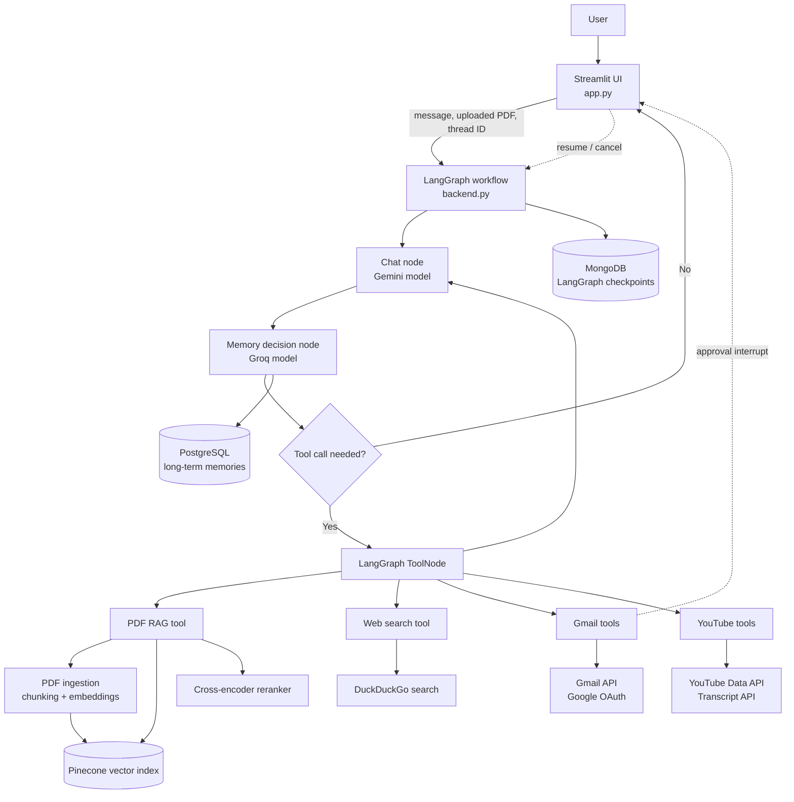

# Atlas — Agentic AI Assistant

Atlas is a Streamlit-based personal AI assistant. It combines conversational AI with document retrieval, web search, Gmail access, and YouTube research in one threaded workspace.

The interface is designed like a modern chat app: create or revisit conversations from the sidebar, attach PDF documents from the chat composer, see tool activity while Atlas works, and receive streamed responses where the configured model supports it.

## What Atlas can do

- Answer questions using uploaded PDF documents.
- Search the web and synthesize relevant results.
- Read Gmail inbox messages and prepare or send email through Gmail.
- Find YouTube videos, obtain transcripts, and explain or summarize their content.
- Keep separate conversation threads and restore their previous messages.
- Store short-term conversation checkpoints and long-term memories separately.
- Show progress/tool activity in the chat UI while the agent is working.

## Architecture



## How a request flows

1. The Streamlit frontend sends the current user message and thread ID to the LangGraph workflow.
2. The chat model decides whether it can answer directly or needs one or more tools.
3. When a tool is needed, the workflow executes it and returns to the chat model with the result.
4. A separate memory-decision model determines whether the latest exchange should be saved as a long-term memory.
5. MongoDB persists the graph checkpoint for the conversation; PostgreSQL holds durable user memories.
6. The frontend renders the response, tool status, and any approval request.

## Project layout

| Path | Purpose |
| --- | --- |
| `app.py` | Streamlit chat interface, thread sidebar, uploads, tool status, and approval controls. |
| `backend.py` | LangGraph workflow, LLM configuration, tools, RAG pipeline, storage connections, and Gmail integration. |
| `requirements.txt` | Python packages required by the app. |
| `gmail_api_secrets.json` | Google OAuth desktop-client credentials; required locally and should remain private. |
| `token.json` | Gmail OAuth token created after authorization; generated locally and should remain private. |

## Tools and integrations

| Capability | Implementation |
| --- | --- |
| Chat and tool reasoning | Google Gemini through `langchain-google-genai` |
| Memory decision | Groq model through `langchain-groq` |
| Document retrieval | BGE embeddings, Pinecone hybrid search, and a cross-encoder reranker |
| Web research | DuckDuckGo search plus page text extraction |
| Gmail | Google Gmail API using OAuth 2.0 |
| YouTube | YouTube Data API for discovery and `youtube-transcript-api` for transcript retrieval |
| Conversation persistence | MongoDB LangGraph checkpointer |
| Long-term memory | PostgreSQL memory store |

## Document retrieval (RAG)

When a PDF is attached in the chat composer, Atlas stores it temporarily, extracts its text, splits it into overlapping chunks, embeds those chunks, and upserts them to Pinecone. When a document question is asked, it performs hybrid retrieval and reranks the candidate chunks before giving the selected context to the model.

The current backend is configured around:

- BGE embeddings (`BAAI/bge-large-en-v1.5`)
- Hybrid Pinecone retrieval
- Candidate retrieval followed by cross-encoder reranking (`BAAI/bge-reranker-large`)
- A Pinecone index named `project-db`

Embedding and reranker objects are loaded lazily to keep initial app startup lighter than loading those models immediately.

## RAG evaluation results

Evaluation of the reranked hybrid-retrieval pipeline produced the following results:

| Metric | Score | Notes |
| --- | ---: | --- |
| Faithfulness | 0.91 | Answers remain well grounded in the retrieved context. |
| Answer relevancy | 0.93 | Answers are highly relevant to the user query. |
| Context precision | 0.89 | Improved from 0.68 after applying cross-encoder reranking to hybrid retrieval. |
| Context recall | 1.00 | All relevant context was retrieved. |

## Conversation threads and memory

Each chat is assigned a unique thread ID. The sidebar reads thread checkpoints from MongoDB so earlier conversations can be reopened. Starting a new chat creates a new thread without intentionally deleting older ones.

Atlas maintains two different kinds of state:

- **Conversation state:** message history and workflow checkpoints, stored in MongoDB.
- **Long-term memory:** facts selected by the memory-decision step, stored in PostgreSQL under the configured user and namespace.

## Email approval flow

Sending an email is a sensitive action. The intended workflow is:

1. Atlas prepares the email and asks the user for confirmation.
2. The send tool pauses the LangGraph workflow with an approval interrupt.
3. The Streamlit UI displays the email details and **Send** / **Cancel** controls.
4. The user's choice resumes the same graph thread.
5. Only an approved request is sent through the Gmail API.

This flow depends on the browser session, the active Streamlit process, Gmail OAuth permissions, and the frontend correctly receiving the LangGraph interrupt. It should be tested with a safe recipient after any backend or model change.

## Prerequisites

- Python 3.11 or newer
- A Google Gemini API key
- A Groq API key
- Pinecone account and API key
- MongoDB instance
- PostgreSQL instance
- Google Cloud OAuth desktop credentials with the Gmail API enabled
- YouTube Data API key for video search
- Network access to the above services and model/package providers

## Configuration

Create a `.env` file in the project root and provide the service credentials used by `backend.py`:

```dotenv
GEMINI_API_KEY=your_gemini_key
GROQ_API_KEY=your_groq_key
PINECONE_API_KEY=your_pinecone_key
MONGODB_URI=your_mongodb_connection_string
POSTGRESQL_URI=your_postgresql_connection_string
YT_API_KEY=your_youtube_data_api_key
HF_TOKEN=optional_hugging_face_token
```

Place the Google OAuth client-secret file at the project root as `gmail_api_secrets.json`. On the first Gmail action, complete the browser-based Google authorization flow; the application creates `token.json` for future sessions.

## Installation and running locally

```powershell
python -m venv .venv
.\.venv\Scripts\Activate.ps1
pip install -r requirements.txt
streamlit run app.py
```

Open the local URL printed by Streamlit, normally `http://localhost:8501`.

## Running with Docker Compose

Docker Compose builds a small Python image for the Streamlit application and exposes it on port `8501`. It reads API/database configuration from the local `.env` file and bind-mounts Gmail OAuth files so secrets are not baked into the image.

Before starting, ensure these local files exist in the project root:

- `.env`
- `gmail_api_secrets.json`
- `token.json` (after completing the first Gmail OAuth authorization)

Then build and run Atlas:

```powershell
docker compose up --build
```

Open `http://localhost:8501`. To run it in the background, use `docker compose up --build -d`; stop it with `docker compose down`.

> Gmail OAuth normally opens a browser during its first authorization. Complete that authorization when running Atlas locally so `token.json` exists, then start the container. The compose configuration reuses that token on later runs.

## Using Atlas

1. Open or create a conversation in the sidebar.
2. Ask a normal question, or attach a PDF with the **+** control in the chat bar.
3. Watch the in-chat activity indicator when Atlas invokes a tool.
4. Reopen previous conversations from the sidebar when needed.
5. Review the email preview and explicitly approve it before sending an email.

## Streaming behavior

The UI consumes LangGraph message/update events so it can render partial assistant output and identify tool calls. Actual token-by-token output also requires the selected chat model client to be configured for streaming. For the current Gemini integration, keep `streaming=True` in the `ChatGoogleGenerativeAI` configuration and restart Streamlit after changing models or backend code.

Some providers or model versions may emit only a completed message even when the workflow uses streaming APIs. In that case Atlas can still display tool activity and then render the final answer, but the text will appear at once.

## Important security notes

- Never commit `.env`, `gmail_api_secrets.json`, or `token.json` to source control.
- Treat Gmail OAuth credentials and database connection strings as secrets.
- Use the minimum Gmail scopes and Google Cloud permissions needed for this project.
- Confirm recipients, subject, and body before approving an email.
- Rotate any key that was accidentally exposed in a commit, screenshot, log, or shared archive.

## Troubleshooting

| Symptom | Checks |
| --- | --- |
| App does not start | Confirm the virtual environment is active and dependencies are installed from `requirements.txt`. |
| Gemini/Groq authentication errors | Check the API keys in `.env`, model availability, and account access. |
| PDF questions return no useful context | Verify Pinecone credentials/index availability and upload the PDF before querying it. |
| Gmail action fails | Ensure Gmail API is enabled, OAuth credentials are present, authorization completed, and the token has the required scopes. |
| Approval buttons do not appear | Restart Streamlit after code changes, confirm the email tool emits a LangGraph interrupt, and inspect the Streamlit terminal for exceptions. |
| Old chats are missing | Check MongoDB connectivity and that the same database/checkpoint collection is being used. |
| Streaming is not visible | Confirm `streaming=True` on the configured chat model; some providers may return one final chunk only. |
